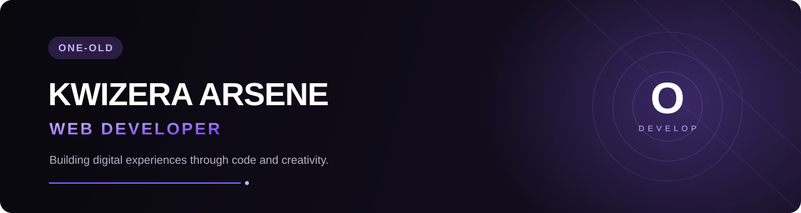

# KWIZERA ARSENE

**Web Developer · Digital Product Builder**

I build responsive websites and practical digital products — from customer-facing platforms to useful software tools.

[Portfolio](https://github.com/ONE-OLD?tab=repositories) · [GitHub](https://github.com/ONE-OLD) · Kigali, Rwanda

---

## About

I enjoy turning ideas into working digital experiences. My work spans frontend development, backend integrations, authentication, databases, deployment and experimentation with AI-powered features.

- Building responsive web applications and digital platforms
- Connecting interfaces to APIs, databases and authentication services
- Exploring AI integration, automation and real-time features
- Learning through practical projects and continuous improvement

## Technology

## Selected work

| Project | What it is | |
|---|---|---|
| **[KigaliPix](https://kigalipix.vercel.app/)** | Photography gallery and business platform | [Code not available](https://github.com/ONE-OLD/) |
| **[KatProgrammers](https://katprogrammers.vercel.app/)** | Programming education and AI-assisted learning platform | [Code not available](https://github.com/ONE-OLD/) |
| **[DMD](https://dreammakerdevelopers.com/)** | Company website for Dream Maker Developers | [Code not available](https://github.com/ONE-OLD/) |
| **[Rwamagana Leaders' School](https://rls-roan.vercel.app/)** | School information and learning-resource website | [Code not available](https://github.com/ONE-OLD/) |
| **[Stella Express](https://bus-rwanda.vercel.app/)** | Bus company website concept | [Code not available](https://github.com/ONE-OLD/) |

## More projects

[TIENS!](https://github.com/ONE-OLD/tiens) · [Mocha Cafe](https://github.com/ONE-OLD/coffee) · [Between Thoughts](https://github.com/ONE-OLD/openmind) · [Personal portfolio](https://github.com/ONE-OLD/my-portfolio) · [Creative experiment](https://github.com/ONE-OLD/arsene)

Some repositories are prototypes, learning projects or private work. Their documentation describes their current scope and setup.

## Currently exploring

- Modern frontend and full-stack application architecture
- Secure authentication and backend design
- AI-powered features and workflow automation
- Real-time communication and data-driven applications

## GitHub at a glance

---

**BUILD WITH PURPOSE. KEEP LEARNING. MAKE IDEAS REAL.**

